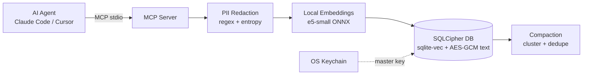

# 🧠 Local AI Memory Bridge

**Persistent, encrypted, fully offline long-term memory for AI agents** (Claude Code, Cursor, and any MCP client).
Your memories never leave your machine.

> ⚠️ **Status: alpha (v0.1).** Save, search, redaction and the MCP server are tested from the CLI and a test MCP client. Not yet tested with every agent. `compact` has had limited testing. Do not rely on it for highly sensitive data yet.

## Why

- 🔒 **Whole-database encryption** (SQLCipher) plus AES-256-GCM on every memory text
- 🔑 **Master key in your OS keychain** (falls back to a `chmod 600` key file where no keychain exists, e.g. Codespaces or Docker)
- 🧹 **Secrets redacted before anything is embedded or stored** (API keys, tokens, passwords, JWTs, private keys, credit cards, emails)
- 🌍 **Multilingual semantic search** (`multilingual-e5-small`, 100+ languages including Arabic), running locally via ONNX
- 🔌 **Native MCP server** over stdio

## Architecture



## Quick Start

Requires Node.js 20 or newer.

```bash
npx -y local-ai-memory-bridge add "I prefer TypeScript for new projects"
npx -y local-ai-memory-bridge search "what language do I prefer?"
npx -y local-ai-memory-bridge setup
```

The first `add` or `search` downloads the embedding model (about 100-150 MB) to `~/.memory-bridge/models`. Run one of them once before connecting an agent, so the agent does not time out on the first call.

### Connect to Claude Code

```bash
claude mcp add memory-bridge -- npx -y local-ai-memory-bridge serve
claude mcp list
```

### Connect to Cursor (`mcp.json`)

```json
{
  "mcpServers": {
    "memory-bridge": {
      "command": "npx",
      "args": ["-y", "local-ai-memory-bridge", "serve"]
    }
  }
}
```

## CLI

| Command | Description |
|---|---|
| `serve` | Run the MCP server (stdio) |
| `add <text> [-p project]` | Save a memory (redacted automatically) |
| `search <query> [-n 5] [-p project]` | Semantic search |
| `forget <id>` | Delete a memory |
| `compact [-d 30] [-t 0.93]` | Merge near-duplicate memories older than N days |
| `stats` | Show counts and DB path |
| `setup` | Print MCP config snippets |

## MCP Tools

| Tool | Input | Purpose |
|---|---|---|
| `memory_save` | `text`, `project?` | Store a durable fact or decision |
| `memory_search` | `query`, `limit?`, `project?` | Semantic recall |
| `memory_forget` | `id` | Delete a memory |

## Configuration

| Env var | Default | Meaning |
|---|---|---|
| `MEMORY_BRIDGE_HOME` | `~/.memory-bridge` | Data directory |
| `MEMORY_BRIDGE_KEY` | *(unset)* | 64-char hex master key override |
| `MEMORY_BRIDGE_MODEL` | `Xenova/multilingual-e5-small` | Embedding model |
| `MEMORY_BRIDGE_MARGIN` | `0.04` | Relevance cut-off relative to the best hit |

## Your encryption key (read this)

Your memories can only be opened with the master key.

- If the OS keychain entry is deleted, or you move to a new machine without the key, **the database cannot be opened and the data is unrecoverable**.
- You will see: `Cannot decrypt memory.db: the master key does not match...`. Either restore your key via `MEMORY_BRIDGE_KEY`, or delete `~/.memory-bridge/memory.db` to start fresh.
- To control the key yourself, generate one (`openssl rand -hex 32`), store it in a password manager, and set it as `MEMORY_BRIDGE_KEY`.
- In ephemeral environments (Codespaces, containers), the key and database may be lost when the environment is deleted.

## Security model and limits

- Redaction is best-effort (patterns plus entropy). It will miss some secrets, so don't rely on it as your only control.
- This protects data at rest on your machine, not against malware running as your user.
- This project has not had an independent security review.

## Roadmap

- [x] One-command install via npm (`npx`)
- [ ] Key export / backup command
- [ ] Optional NER-based PII detection
- [ ] Optional local-LLM summarization (Ollama)
- [ ] Tests and CI

## License

MIT
