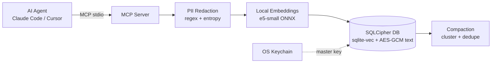

<!-- README.md — Local AI Memory Bridge | نسخة عربية (RTL) + عناصر تقنية إنجليزية -->

<div dir="rtl" align="right">

<h1>🧠 جسر ذاكرة الذكاء الاصطناعي المحلي</h1>

<p><strong>ذاكرة طويلة الأمد دائمة ومشفّرة تعمل دون اتصال بالإنترنت بالكامل لوكلاء الذكاء الاصطناعي</strong> (Claude Code وCursor وأي عميل MCP).<br>
ذكرياتك لا تغادر جهازك أبدًا.</p>

<blockquote>
<p>⚠️ <strong>الحالة: نسخة ألفا (v0.1).</strong> الحفظ والبحث والتنقيح وخادم MCP تم اختبارها من سطر الأوامر ومن عميل MCP تجريبي. لم يتم اختبارها بعد مع كل وكيل. أمر <code dir="ltr">compact</code> خضع لاختبار محدود. لا تعتمد عليه للبيانات شديدة الحساسية بعد.</p>
</blockquote>

<h2>لماذا</h2>

<ul>
<li>🔒 <strong>تشفير كامل لقاعدة البيانات</strong> (SQLCipher) بالإضافة إلى AES-256-GCM على كل نص ذاكرة</li>
<li>🔑 <strong>مفتاح رئيسي في سلسلة مفاتيح نظام التشغيل لديك</strong> (مع الرجوع إلى ملف مفتاح بصلاحيات <code dir="ltr">chmod 600</code> حيث لا توجد سلسلة مفاتيح، مثل Codespaces أو Docker)</li>
<li>🧹 <strong>تنقيح الأسرار قبل تضمين أي شيء أو تخزينه</strong> (مفاتيح API، والرموز، وكلمات المرور، ورموز JWT، والمفاتيح الخاصة، وبطاقات الائتمان، والبريد الإلكتروني)</li>
<li>🌍 <strong>بحث دلالي متعدد اللغات</strong> (<code dir="ltr">multilingual-e5-small</code>، أكثر من 100 لغة بما فيها العربية)، يعمل محليًا عبر ONNX</li>
<li>🔌 <strong>خادم MCP أصلي</strong> عبر stdio</li>
</ul>

<h2>البنية</h2>

</div>



<div dir="rtl" align="right">

<h2>البدء السريع</h2>

<p>يتطلب Node.js 20 أو أحدث.</p>

</div>

```bash
npx -y local-ai-memory-bridge add "I prefer TypeScript for new projects"
npx -y local-ai-memory-bridge search "what language do I prefer?"
npx -y local-ai-memory-bridge setup
```

<div dir="rtl" align="right">

<p>أول عملية <code dir="ltr">add</code> أو <code dir="ltr">search</code> تنزّل نموذج التضمين (حوالي 100-150 ميغابايت) إلى <code dir="ltr">~/.memory-bridge/models</code>. شغّل واحدة منهما مرة واحدة قبل توصيل وكيل، حتى لا ينتهي وقت الوكيل في الاستدعاء الأول.</p>

<h3>الاتصال بـ Claude Code</h3>

</div>

```bash
claude mcp add memory-bridge -- npx -y local-ai-memory-bridge serve
claude mcp list
```

<div dir="rtl" align="right">

<h3>الاتصال بـ Cursor (<code dir="ltr">mcp.json</code>)</h3>

</div>

```json
{
  "mcpServers": {
    "memory-bridge": {
      "command": "npx",
      "args": ["-y", "local-ai-memory-bridge", "serve"]
    }
  }
}
```

<div dir="rtl" align="right">

<h2>سطر الأوامر (CLI)</h2>

<table dir="rtl">
<thead>
<tr><th>الأمر</th><th>الوصف</th></tr>
</thead>
<tbody>
<tr><td><code dir="ltr">serve</code></td><td>تشغيل خادم MCP (stdio)</td></tr>
<tr><td><code dir="ltr">add &lt;text&gt; [-p project]</code></td><td>حفظ ذاكرة (تُنقَّح تلقائيًا)</td></tr>
<tr><td><code dir="ltr">search &lt;query&gt; [-n 5] [-p project]</code></td><td>بحث دلالي</td></tr>
<tr><td><code dir="ltr">forget &lt;id&gt;</code></td><td>حذف ذاكرة</td></tr>
<tr><td><code dir="ltr">compact [-d 30] [-t 0.93]</code></td><td>دمج الذكريات شبه المكررة الأقدم من N يومًا</td></tr>
<tr><td><code dir="ltr">stats</code></td><td>عرض الأعداد ومسار قاعدة البيانات</td></tr>
<tr><td><code dir="ltr">setup</code></td><td>طباعة مقتطفات إعداد MCP</td></tr>
</tbody>
</table>

<h2>أدوات MCP</h2>

<table dir="rtl">
<thead>
<tr><th>الأداة</th><th>المدخل</th><th>الغرض</th></tr>
</thead>
<tbody>
<tr><td><code dir="ltr">memory_save</code></td><td><code dir="ltr">text</code>, <code dir="ltr">project?</code></td><td>تخزين حقيقة أو قرار دائم</td></tr>
<tr><td><code dir="ltr">memory_search</code></td><td><code dir="ltr">query</code>, <code dir="ltr">limit?</code>, <code dir="ltr">project?</code></td><td>استدعاء دلالي</td></tr>
<tr><td><code dir="ltr">memory_forget</code></td><td><code dir="ltr">id</code></td><td>حذف ذاكرة</td></tr>
</tbody>
</table>

<h2>الإعدادات</h2>

<table dir="rtl">
<thead>
<tr><th>متغير البيئة</th><th>الافتراضي</th><th>المعنى</th></tr>
</thead>
<tbody>
<tr><td><code dir="ltr">MEMORY_BRIDGE_HOME</code></td><td><code dir="ltr">~/.memory-bridge</code></td><td>دليل البيانات</td></tr>
<tr><td><code dir="ltr">MEMORY_BRIDGE_KEY</code></td><td><em>(غير مضبوط)</em></td><td>تجاوز المفتاح الرئيسي بسلسلة سداسية عشرية من 64 حرفًا</td></tr>
<tr><td><code dir="ltr">MEMORY_BRIDGE_MODEL</code></td><td><code dir="ltr">Xenova/multilingual-e5-small</code></td><td>نموذج التضمين</td></tr>
<tr><td><code dir="ltr">MEMORY_BRIDGE_MARGIN</code></td><td><code dir="ltr">0.04</code></td><td>حد الصلة نسبةً إلى أفضل نتيجة</td></tr>
</tbody>
</table>

<h2>مفتاح التشفير الخاص بك (اقرأ هذا)</h2>

<p>لا يمكن فتح ذكرياتك إلا بالمفتاح الرئيسي.</p>

<ul>
<li>إذا حُذف إدخال سلسلة مفاتيح نظام التشغيل، أو انتقلت إلى جهاز جديد دون المفتاح، <strong>فلن يمكن فتح قاعدة البيانات وستكون البيانات غير قابلة للاسترداد</strong>.</li>
<li>سترى: <code dir="ltr">Cannot decrypt memory.db: the master key does not match...</code>. إما أن تستعيد مفتاحك عبر <code dir="ltr">MEMORY_BRIDGE_KEY</code>، أو تحذف <code dir="ltr">~/.memory-bridge/memory.db</code> لتبدأ من جديد.</li>
<li>للتحكم في المفتاح بنفسك، ولّد واحدًا (<code dir="ltr">openssl rand -hex 32</code>)، واحفظه في مدير كلمات المرور، واضبطه كـ <code dir="ltr">MEMORY_BRIDGE_KEY</code>.</li>
<li>في البيئات المؤقتة (Codespaces والحاويات)، قد يُفقد المفتاح وقاعدة البيانات عند حذف البيئة.</li>
</ul>

<h2>نموذج الأمان والحدود</h2>

<ul>
<li>التنقيح هو أفضل جهد ممكن (أنماط + إنتروبيا). سيفوته بعض الأسرار، لذا لا تعتمد عليه كضابط وحيد لديك.</li>
<li>هذا يحمي البيانات في حالة السكون على جهازك، وليس ضد البرمجيات الخبيثة التي تعمل بصلاحيات مستخدمك.</li>
<li>لم يخضع هذا المشروع لمراجعة أمنية مستقلة.</li>
</ul>

<h2>خارطة الطريق</h2>

<ul>
<li>✅ تثبيت بأمر واحد عبر npm (<code dir="ltr">npx</code>)</li>
<li>⬜ أمر تصدير / نسخ احتياطي للمفتاح</li>
<li>⬜ كشف اختياري لبيانات PII المعتمد على NER</li>
<li>⬜ تلخيص اختياري بنموذج لغوي محلي (Ollama)</li>
<li>⬜ الاختبارات والتكامل المستمر (CI)</li>
</ul>

<h2>الترخيص</h2>

<p>MIT</p>

</div>
